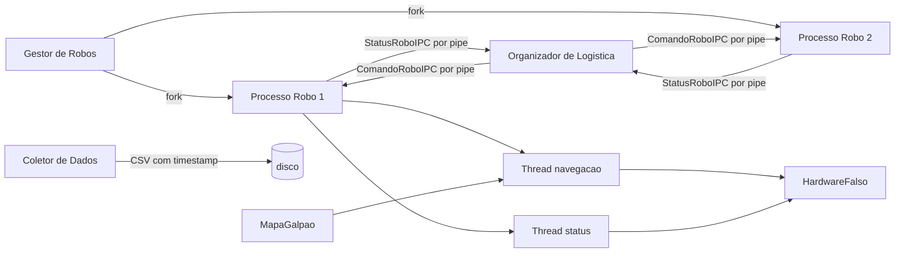

# Trabalho de Robos Moveis - Etapa 1

Implementacao em C++17 de um sistema centralizado para robos moveis
autonomos. Na Etapa 1, o Gestor cria um processo Linux separado para cada
robo com `fork()`. Cada processo inicia threads de navegacao e status e
troca dados com o Organizador por pipes POSIX. MQTT, telas e simulacao
grafica ficam para a Etapa 2.

## Requisitos

- Linux
- compilador C++ com suporte a C++17
- CMake 3.16 ou superior
- pthreads (localizado automaticamente pelo CMake)

## Compilar e executar

Todos os caminhos sao relativos ao diretorio raiz do projeto:

```bash
cmake -S . -B build
cmake --build build -j
./build/atr
```

O executavel cria um processo de robo, envia uma carga pelo Organizador e
aguarda a entrega. Para executar toda a verificacao:

```bash
ctest --test-dir build --output-on-failure
```

## Arquitetura da Etapa 1



`ContextoRobo::mtx` protege os dados compartilhados dentro de cada processo.
A thread de navegacao
possui periodo de 50 ms e a thread de status possui periodo de 100 ms.
`HardwareFalso` possui uma thread propria, executada a cada 100 ms, e
protege suas entradas e saidas com outro mutex. Os pipes carregam estruturas
binarias de tamanho fixo: comandos descem do Organizador para o filho e
snapshots de status sobem para o processo pai.

## O que ja esta implementado

- mapa 2D com baias, zonas, carregadores e corredores restritos
- busca de menor caminho respeitando a capacidade dos corredores
- fila produtor-consumidor com `mutex`, `condition_variable` e timeout
- temporizador periodico com medicao de jitter
- hardware falso com movimento, bateria, acoplamento e injecao de falha
- processo Linux separado para cada robo com `fork()`
- duas threads em cada processo: navegacao e status
- IPC bidirecional por pipes POSIX
- Gestor, Organizador e Coletor funcionais
- grupo de 1 a 4 robos para uma carga
- testes unitarios e testes de integracao entre processos

## Limites da Etapa 1

Esta etapa implementa os processos, threads, mapa, hardware simulado,
Gestor, Organizador, Coletor e IPC. MQTT, tela de operacao e interface
grafica ainda nao existem porque foram reservados para a Etapa 2.
