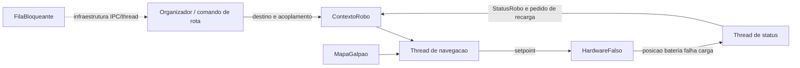

# Trabalho de Robos Moveis - Etapa 1

Implementacao em C++17 de um sistema centralizado para robos moveis autonomos. A Etapa 1: tarefas embarcadas e troca
de dados entre o hardware simulado, a navegacao e o status do robo. MQTT, telas e simulacao grafica ficam para a Etapa 2, de acordo com o documento do trabalho.

## Requisitos

- Linux
- compilador C++ com suporte a C++17
- CMake 3.16 ou superior
- pthreads (localizado automaticamente pelo CMake)

## Compilar e executar

Todos os caminhos sao relativos ao diretorio raiz do projeto:

```bash
cmake -S . -B build
cmake --build build -j
./build/atr
```

O executavel cria um robo, envia um destino e imprime o ultimo status lido
pelas threads. Para executar toda a verificacao:

```bash
ctest --test-dir build --output-on-failure
```

## Arquitetura da Etapa 1



`ContextoRobo::mtx` protege os dados compartilhados. A thread de navegacao
possui periodo de 50 ms e a thread de status possui periodo de 100 ms.
`HardwareFalso` possui uma thread propria, executada a cada 100 ms, e
protege suas entradas e saidas com outro mutex.

## O que ja esta implementado

- mapa 2D com baias, zonas, carregadores e corredores restritos
- busca de menor caminho respeitando a capacidade dos corredores
- fila produtor-consumidor com `mutex`, `condition_variable` e timeout
- temporizador periodico com medicao de jitter
- hardware falso com movimento, bateria, acoplamento e injecao de falha
- processo logico de robo com threads de navegacao e status
- testes unitarios e teste de integracao da troca de dados entre as threads

