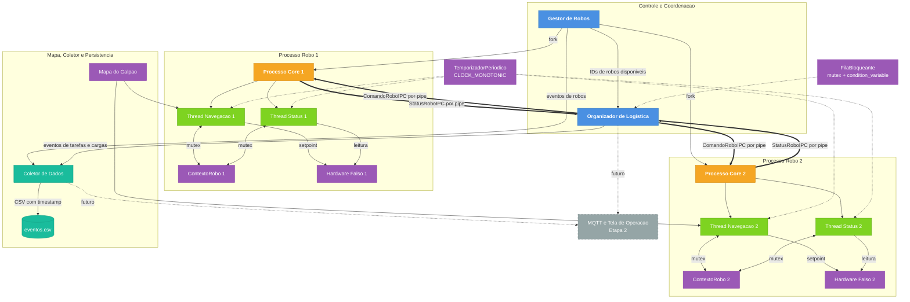

# Trabalho de Robos Moveis - Etapa 1

Implementação em C++17 de um sistema centralizado para robôs móveis autônomos. Na Etapa 1, o Gestor cria um processo Linux separado para cada robô com `fork()`. Cada processo inicia threads de navegação e status e troca dados com o Organizador por pipes POSIX.

## Requisitos

- Linux
- Compilador C++ com suporte a C++17
- CMake
- pthreads

## Compilar e executar

Todos os caminhos são referentes ao diretório raiz do projeto:

```bash
cmake -S . -B build
cmake --build build -j
./build/atr
```

O executável cria um processo de robô, envia uma carga pelo Organizador e aguarda a entrega. Para executar toda a verificação:

```bash
ctest --test-dir build --output-on-failure
```

## Arquitetura da Etapa 1



`ContextoRobo::mtx` protege os dados compartilhados dentro de cada processo. A thread de navegação possui periodo de 50 ms e a thread de status possui período de 100 ms.
`HardwareFalso` possui uma thread própria, executada a cada 100 ms, e protege suas entradas e saidas com outro mutex. Os pipes carregam estruturas binárias de tamanho fixo, comandos descem do Organizador para o filho e os status sobem para o processo pai.
