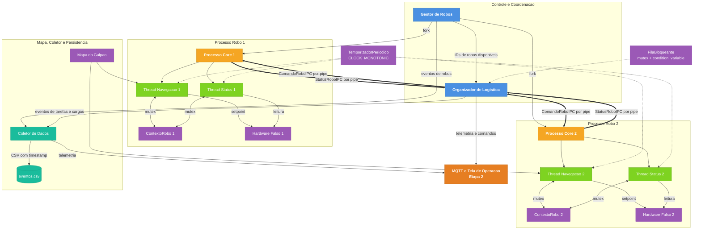

# Trabalho de Robos Moveis - Etapas 1 e 2

Implementação em C++17 de um sistema centralizado para robôs móveis autônomos. O Gestor cria um processo Linux separado para cada robô com `fork()`. Cada processo inicia threads de navegação e status e troca dados com o Organizador por pipes POSIX. A interface Pygame acompanha a telemetria, envia comandos operacionais e pode usar MQTT.

## Requisitos

- Linux
- Compilador C++ com suporte a C++17
- CMake
- pthreads
- Python 3 e Pygame para o simulador gráfico

## Compilar e executar

Todos os caminhos são referentes ao diretório raiz do projeto:

```bash
cmake -S . -B build
cmake --build build -j
./build/atr
```

O executável cria um processo de robô, envia uma carga pelo Organizador e aguarda a entrega. Para executar toda a verificação:

```bash
ctest --test-dir build --output-on-failure
```

Para medir criação de processos, tempo de disponibilização e latência de comando
para 1 a 4 robôs:

```bash
./build/benchmark_escalabilidade
```

O resultado é impresso em CSV com cinco repetições e as colunas `repeticao`,
`robos`, `criacao_ms`, `online_ms` e `latencia_bateria_ms`.
As linhas brutas também são salvas em `benchmark_escalabilidade.csv`. No
terminal, o programa exibe um resumo com média, mínimo e máximo de cada medida
para cada quantidade de robôs. Valores `-1` indicam que o limite de espera foi
atingido sem receber a resposta.

### Resultados registrados

O arquivo `benchmark_escalabilidade.csv` contém cinco repetições por quantidade
de robôs. As médias registradas foram:

| Robôs | Criação | Online | Latência da bateria |
|---:|---:|---:|---:|
| 1 | 0,0 ms | 223,0 ms | 101,0 ms |
| 2 | 0,8 ms | 263,6 ms | 101,2 ms |
| 3 | 1,2 ms | 284,4 ms | 101,2 ms |
| 4 | 2,4 ms | 304,0 ms | 100,8 ms |

O aumento do tempo para os robôs ficarem online acompanha a criação de mais
processos. A latência do comando de bateria permanece próxima de 100 ms,
compatível com o período da thread de status.

### Roteiro de demonstração da Etapa 2

1. Iniciar o Mosquitto e executar `python3 simulador.py`.
2. Mostrar os robôs e a missão colaborativa no mapa.
3. Selecionar robôs pelas teclas `1` a `4`.
4. Ativar o modo manual com `M` e enviar um destino pelo mapa.
5. Desativar `M` e mostrar o retorno do robô ao estado automático/disponível.
6. Usar `F` ou o comando MQTT `falha <id> on|off`.
7. Alterar a bateria com `B` ou `bateria <id> <nivel>`.
8. Adicionar caixas com `C` e um robô com `N`.
9. Mostrar a publicação em `atr/telemetria` e o recebimento em
   `atr/comandos`.
10. Encerrar a interface e confirmar que o backend é finalizado junto.

## Simulador e MQTT

```bash
python3 simulador.py
```

Ao fechar a janela ou pressionar `Ctrl+C`, o simulador encerra também o
backend-filho e os processos dos robôs.

Com um broker Mosquitto em `127.0.0.1:1883`, a tela e o backend usam MQTT:

```bash
./build/atr_telemetria --mqtt
```

Os tópicos são:

- `atr/telemetria`: estados JSON publicados pelo backend;
- `atr/comandos`: comandos operacionais recebidos pelo backend.

O simulador envia periodicamente `PINGREQ` para manter a assinatura MQTT ativa
mesmo quando nenhum comando é enviado pela interface.

Sem broker, a tela usa automaticamente o canal local de entrada do backend.

## Arquitetura da Etapa 1



`ContextoRobo::mtx` protege os dados compartilhados dentro de cada processo. A thread de navegação possui periodo de 50 ms e a thread de status possui período de 100 ms.
`HardwareFalso` possui uma thread própria, executada a cada 100 ms, e protege suas entradas e saidas com outro mutex. Os pipes carregam estruturas binárias de tamanho fixo, comandos descem do Organizador para o filho e os status sobem para o processo pai.
